<a href="https://github.com/Yuvansh-Shah?tab=repositories"></a>

I build autonomous systems end to end: systematic trading infrastructure, transformer language models trained from scratch, LLM evaluation research, and cross-platform applications. Each listing below links to its repo.

<a href="https://github.com/Yuvansh-Shah/algo-trading-platform"></a>

<a href="https://github.com/Yuvansh-Shah/dialect-bias-llm"></a>
<a href="https://github.com/Yuvansh-Shah/research-paper-llm"></a>
<a href="https://github.com/Yuvansh-Shah/JainQuest"></a>
<a href="https://github.com/Yuvansh-Shah/jainquest-web"></a>
<a href="https://github.com/Yuvansh-Shah/flowlite"></a>
<a href="https://github.com/Yuvansh-Shah/satforge"></a>
<a href="https://github.com/Yuvansh-Shah/tt-robot-app"></a>
<a href="https://github.com/Yuvansh-Shah/sadhana-eye-care"></a>


Every graphic on this page is a hand-written animated SVG generated by <a href="scripts/build.py"><code>scripts/build.py</code></a>. No widgets, no third-party image services.
